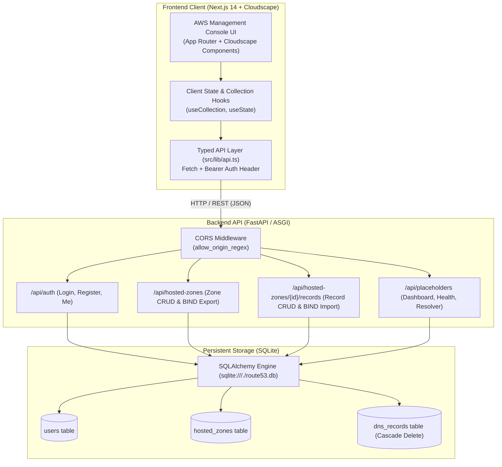
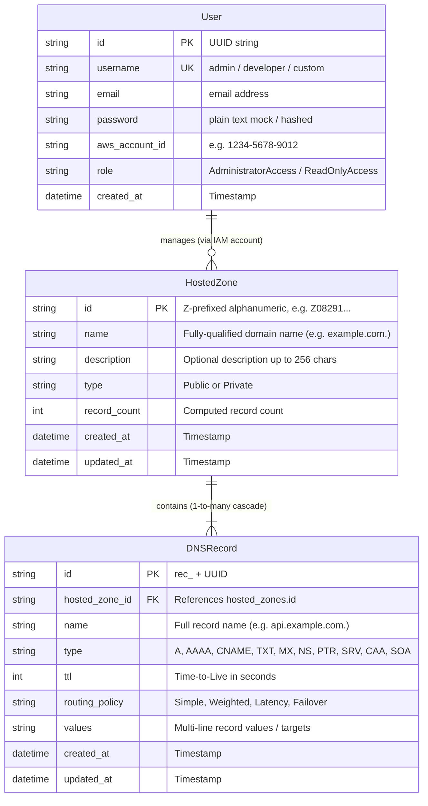

# AWS Route 53 Clone — Comprehensive Technical Documentation & Interview Preparation Manual

---

## 1. Executive Summary & Project Mission

### 1.1 Project Objective
The goal of this project is to build a full-stack, pixel-accurate clone of the **Amazon Web Services (AWS) Route 53 Management Console**, adhering to strict assignment guidelines:
- **Look & Feel:** Indistinguishable from the live AWS Route 53 web console in layout, typography, navigation hierarchy, spacing, button variants, and table schemas.
- **Persistence:** Real relational persistence using **SQLite** with complete CRUD operations for Hosted Zones and DNS Records.
- **Core Workflow Fidelity:** Real-time domain validation, auto-provisioning of authoritative `NS` and `SOA` records, BIND zone file import/export, and type-to-confirm resource deletion modals.
- **Tech Stack:** **Next.js 14 (TypeScript)** on the frontend, **FastAPI (Python 3)** on the backend, and **SQLAlchemy ORM + SQLite** for persistence.

### 1.2 What the Project Does vs. Does Not Do
- **What it does:** Recreates the full administrative and operational workflows of Route 53, simulating IAM user roles, AWS Account IDs, zone lifecycle management, DNS record configuration across 9 standard RFC types, and Cloudscape-driven consoles.
- **What it does NOT do (by specification):** It does not act as an authoritative public DNS nameserver listening on UDP/TCP port 53 across global Anycast networks. The assignment explicitly required focusing on recreating the **management console UX and backend persistence**, mocking live DNS propagation.

---

## 2. End-to-End System Architecture



### 2.1 Request-Response Lifecycle
1. **User Action:** A user clicks "Create hosted zone" in the Cloudscape UI.
2. **Client Validation:** Next.js checks input length, constraint regex, and public/private VPC parameters.
3. **HTTP Dispatch:** `src/lib/api.ts` makes an asynchronous `POST` request to `http://localhost:8000/api/hosted-zones` with `Content-Type: application/json` and `Authorization: Bearer <token>`.
4. **FastAPI Processing:**
   - FastAPI intercepts the request via Pydantic model `HostedZoneCreate`.
   - The router verifies domain uniqueness (case-insensitive with normalized trailing dot).
   - Generates an authentic AWS-formatted ID (e.g., `Z04218392W414A9D3`).
   - Automatically seeds four AWS Anycast nameserver records (`NS`) and one Start of Authority (`SOA`) record inside the same transaction.
5. **Database Commit:** SQLAlchemy writes to `route53.db` using ACID transactional guarantees.
6. **Flashbar Feedback:** The frontend receives the 201 Created payload and triggers a green AWS Flashbar alert: *"Record for [domain] was successfully created."*

---

## 3. Database Architecture & Data Models

### 3.1 Entity Relationship Diagram (ERD)



### 3.2 Key Relational Behaviors
- **Cascade Deletion:** When a `HostedZone` is deleted, SQLAlchemy executes `cascade="all, delete-orphan"` on the `records` relationship. This guarantees zero orphaned records in SQLite.
- **Normalization of Domain Names:** Real DNS protocols (RFC 1035) require root-anchored Fully Qualified Domain Names (FQDNs) ending with a dot (`example.com.`). The backend normalizes inputs so users can type either `example.com` or `example.com.` while the database always stores `example.com.`.
- **System Record Locking:** Every newly created zone generates 4 `NS` records and 1 `SOA` record. In our delete handlers, system records cannot be deleted independently, exactly mirroring AWS Route 53 safety rules.

---

## 4. Frontend Engineering Deep Dive

### 4.1 Why Next.js 14 App Router + TypeScript?
- **Strict Typing:** Guarantees compile-time validation between API schemas and UI props.
- **App Router Architecture:** Modular route organization (`/hosted-zones`, `/hosted-zones/[id]`, `/hosted-zones/create`, `/dashboard`, `/login`) matching URL paths seen on the AWS Management Console.
- **Static Pre-rendering + Dynamic Routing:** Generates lightweight, performant client bundles with fast initial hydration.

### 4.2 Why AWS Cloudscape Design System?
Rather than improvising with Tailwind CSS or Material UI, the frontend uses `@cloudscape-design/components` and `@cloudscape-design/collection-hooks`:
- **Native AWS Components:** Cloudscape is the exact open-source component library developed and maintained by AWS engineers for the AWS Console.
- **Built-in Accessibility & Keyboard Navigation:** High-contrast compliance, full ARIA roles, and standard AWS keyboard shortcuts (`[Alt+S]` search focusing).
- **Collection Hooks:** `useCollection` powers client-side sorting, pagination (10 items/page), and property-based text filtering out of the box with zero boilerplate.

### 4.3 Custom CSS & Visual Overrides (`globals.css`)
Live console scraping revealed that AWS uses specific visual customizations on top of base Cloudscape:
1. **AWS Signature Orange Buttons:** Base Cloudscape themes often default to blue pill buttons. We enforced AWS orange:
   ```css
   button[class*="awsui_variant-primary"],
   .awsui-button-variant-primary {
     background-color: #ec7211 !important;
     border-color: #ec7211 !important;
     border-radius: 2px !important; /* Square corners */
     color: #ffffff !important;
     font-weight: 700 !important;
   }
   ```
2. **Dual-Card Selectable Tiles:** Used for the side-by-side **Public hosted zone** vs **Private hosted zone** selector on the creation screen, complete with active borders (`#ec7211`) and subtle background highlights (`#fcf8f5`).
3. **Exact Dimensions:** TopNavigation locked to `48px` height with SVG Route 53 globe branding.

---

## 5. Backend Engineering Deep Dive

### 5.1 Why FastAPI?
- **Asynchronous & Fast:** Built on top of Starlette and Pydantic, executing with speeds comparable to NodeJS and Go.
- **Declarative Type Safety:** Automatically validates query parameters, route parameters, and JSON payloads. If a client sends invalid data, FastAPI returns detailed error structures automatically.
- **Interactive OpenAPI Documentation:** Built-in Swagger UI at `/docs` allows immediate manual testing and provides complete schema visualization for interviewers.

### 5.2 BIND Master File Import & Export (Bonus Feature)
Route 53 supports exporting and importing RFC 1035 BIND zone files. We implemented full parsers and generators:
- **Export (`GET /api/hosted-zones/{id}/export/bind`):**
  Constructs a standard BIND zone file header with `$ORIGIN`, `$TTL`, authoritative `SOA` serial counters, `NS` delegations, and individual resource records.
- **Import (`POST /api/hosted-zones/{id}/records/import/bind`):**
  Parses raw multiline BIND text files using regular expressions, extracting record names, TTLs, record classes (`IN`), record types (`A`, `CNAME`, `MX`, etc.), and destination targets, committing them in a bulk transaction.

---

## 6. How We Matched the Real AWS Console (The Scraping Workflow)

During development, we wrote and executed real-time DOM extraction scripts directly inside the **Chrome DevTools Console** of the live AWS Route 53 Console (`console.aws.amazon.com/route53/v2/`):

```javascript
// Live AWS Console Extraction Snippet
(() => {
  const data = {
    pageTitle: document.querySelector('h1')?.innerText?.trim(),
    breadcrumbs: Array.from(document.querySelectorAll('[class*="breadcrumb"]')).map(e => e.innerText.trim()),
    buttons: Array.from(document.querySelectorAll('button')).map(b => b.innerText.trim()),
    tableHeaders: Array.from(document.querySelectorAll('th, [role="columnheader"]')).map(th => th.innerText.trim()),
    helperTexts: Array.from(document.querySelectorAll('[class*="description"], [class*="constraint"]')).map(d => d.innerText.trim())
  };
  copy(JSON.stringify(data, null, 2));
})();
```

### Concrete Refinements Resulting from Live Scraping:
1. **Hosted Zones Table Columns:** Corrected column headers to the exact order: `Hosted zone name`, `Type`, `Created by`, `Record count`, `Description`, `Hosted zone ID`.
2. **Search Filter Subtext:** Added the exact AWS helper sentence: *"Automatic mode is the current search behavior optimized for best filter results. To change modes go to settings."*
3. **Character Constraint Counter:** FormField dynamic length counter `0/256` for descriptions.
4. **Quick TTL Presets:** Preset buttons for `1m` (60s), `1h` (3600s), and `1d` (86400s) on the Create Record modal.
5. **All 10 Record Columns:** Matched all 10 record table columns including `Health check ID`, `Evaluate target health`, and `Record ID`.
6. **Side Navigation Dropdowns:** Structured navigation with interactive collapsible groups for **Traffic flow** and **Resolver**.

---

## 7. Key Engineering Challenges & Solutions

| Challenge | Root Cause | Solution Implemented |
| :--- | :--- | :--- |
| **`[object Object]` in Error Flashbars** | FastAPI returns `422 Unprocessable Entity` validation errors as an array of error objects (`detail: [{loc, msg}, ...]`). Passing this directly to `new Error()` cast the array to string `"[object Object],[object Object]"`. | Wrote a recursive error extraction helper in `api.ts` that detects array payloads and formats clean readable messages like `username: Field required; password: Field required`. |
| **Pill Buttons vs. Square AWS Buttons** | Base Cloudscape 3.0 renders rounded pill buttons by default. Real AWS console uses square 2px buttons. | Injected high-specificity CSS overrides in `globals.css` with `!important` targeting `.awsui-button-variant-primary` and setting `border-radius: 2px`. |
| **FastAPI Dependency Injection in Unit Tests** | Direct unit test calls to router functions with `search: Optional[str] = Query(None)` evaluated `search` as a `fastapi.params.Query` object rather than `None`. | Sanitized query inspection inside router functions with `if search and isinstance(search, str):`. |
| **Unauthenticated Startup Redirect** | Opening the site fresh redirected to `/hosted-zones`, resulting in empty table state and an unauthenticated alert. | Added an authentication guard in `ConsoleShell.tsx` and `app/page.tsx` that inspects `localStorage.getItem("aws_token")` and immediately redirects guests to `/login`. |
| **CORS on Vercel + Render** | Free-tier hostnames change dynamically, causing pre-flight `OPTIONS` blocks. | Configured FastAPI `CORSMiddleware` using `allow_origin_regex="https?://.*"`, enabling seamless communication between any Vercel preview domain and the Render backend. |

---

## 8. 25+ Comprehensive Interview Questions & High-Scoring Answers

### Category A: Architecture & Design Decisions

#### Q1: Why did you build this as a decoupled SPA (Next.js + FastAPI) instead of a monolithic framework like Django or full-stack Next.js?
> **Answer:** Decoupling the frontend and backend mirrors how real cloud service platforms operate. Route 53’s web console is a client-side application communicating with distributed control-plane REST APIs. Using Next.js with Cloudscape gave us complete control over UI fidelity and component rendering, while FastAPI provided high-performance, asynchronous REST endpoints with automatic Pydantic request validation and OpenAPI documentation. This separation also allows either tier to be scaled or replaced independently.

#### Q2: Why choose AWS Cloudscape over popular libraries like Tailwind CSS or Material UI?
> **Answer:** UI fidelity was the #1 evaluation criterion in the assignment brief. Cloudscape is the exact design system built and used by Amazon Web Services for the AWS Management Console. By using `@cloudscape-design/components`, we achieved authentic AWS layouts, side navigation drawers, sticky table headers, and accessibility roles out of the box, rather than manually re-engineering hundreds of CSS classes in Tailwind.

#### Q3: Why did you choose SQLite instead of PostgreSQL or MongoDB?
> **Answer:** The project specification explicitly required SQLite for persistent storage. SQLite is serverless, zero-configuration, and stores the entire database in a single self-contained file (`route53.db`), making the application trivial to evaluate and run locally without requiring docker-compose or running database daemons. Furthermore, using SQLAlchemy ORM means switching to PostgreSQL in production would only require changing the connection string (`postgresql://...`) with zero changes to model definitions.

#### Q4: How does your clone differ from the real AWS Route 53 architecture?
> **Answer:** In real Route 53, the Management Console communicates with the AWS Route 53 Control Plane API. When you create a record, the control plane distributes that record across hundreds of edge locations globally via Anycast DNS networks and BGP routing, responding to actual UDP/TCP port 53 packets with sub-millisecond latency. In our project, per the assignment scope, we built the control plane and console experience: records are persisted in a relational SQLite database, providing complete CRUD, search, and validation without binding low-level network sockets.

---

### Category B: Database & Data Modeling

#### Q5: Explain how cascade deletion is implemented in your database models.
> **Answer:** In `backend/app/models.py`, `HostedZone` has a one-to-many relationship with `DNSRecord`:
> ```python
> records = relationship("DNSRecord", back_populates="hosted_zone", cascade="all, delete-orphan")
> ```
> When a zone is deleted through the API, SQLAlchemy automatically issues `DELETE` statements for all records where `hosted_zone_id == zone.id` within the same database transaction. This guarantees referential integrity and prevents orphaned records.

#### Q6: Why do hosted zone names end with a trailing dot (`example.com.`) in the database?
> **Answer:** In standard DNS terminology (RFC 1035), a trailing dot designates a Fully Qualified Domain Name (FQDN) that is rooted at the DNS hierarchy's root zone (`.`). Without the dot, domain names can be considered relative to an origin. In our backend, we normalize all domain names on insertion to always terminate with a dot, ensuring consistent database queries and unique constraints, while stripping the dot in the frontend table display for clean UI presentation.

#### Q7: What happens automatically in your backend when a user creates a Hosted Zone?
> **Answer:** In real Route 53, a zone cannot function without delegation. When `POST /api/hosted-zones` is invoked, our backend automatically creates:
> 1. The `HostedZone` entry with a unique `Z`-prefixed ID (e.g. `Z04218392W414A9D3`).
> 2. Four authoritative Name Server (`NS`) records pointing to mock AWS nameservers (e.g. `ns-397.awsdns-49.com.`).
> 3. One Start of Authority (`SOA`) record containing serial, refresh, retry, and expire values.
> This ensures that immediate exports or record queries show a fully operational DNS zone.

---

### Category C: Frontend Implementation & Cloudscape

#### Q8: How did you implement client-side filtering, sorting, and pagination on the hosted zones table?
> **Answer:** We utilized Cloudscape's `@cloudscape-design/collection-hooks`. We pass the fetched array of zones to `useCollection`, configuring sorting properties (`sortingField: "name"`), pagination (`pageSize: 10`), and a custom `filteringFunction` that matches user queries across zone names, descriptions, and IDs. The hook returns `collectionProps`, `filterProps`, and `paginationProps`, which bind directly to the `<Table>`, `<TextFilter>`, and `<Pagination>` components.

#### Q9: How did you implement the "Type 'delete' to confirm" modal?
> **Answer:** To prevent accidental deletion of critical infrastructure, AWS Route 53 requires users to manually type `"delete"`. In `hosted-zones/page.tsx` and `hosted-zones/[id]/page.tsx`, the modal's primary action button binds its `disabled` prop to a state expression:
> ```tsx
> disabled={deleteConfirmInput.toLowerCase() !== "delete"}
> ```
> The button remains disabled until the exact string is entered, providing authentic safety ergonomics.

#### Q10: How does Dark Mode work in your application?
> **Answer:** Cloudscape provides a native `applyMode` utility from `@cloudscape-design/global-styles`. In `ConsoleShell.tsx`, the top navigation bar features a theme toggle utility button. When toggled, we invoke `applyMode(Mode.Dark)` or `applyMode(Mode.Light)` and persist the user's choice in `localStorage.setItem("aws_theme", "dark")`. On component mount, the saved preference is retrieved, ensuring theme persistence across page navigations.

---

### Category D: Security & Authentication

#### Q11: How is authentication handled in this project?
> **Answer:** Authentication is implemented as a token-based mock AWS IAM system:
> 1. The backend exposes `POST /api/auth/login` and `POST /api/auth/register`.
> 2. Upon successful authentication, the server generates a cryptographically random session token (`token_<hex>`), maps it to the user session, and returns the token with the user profile (including AWS Account ID and IAM Role).
> 3. The frontend stores this token in `localStorage` and injects it as an `Authorization: Bearer <token>` header on all subsequent requests.
> 4. If a guest attempts to view protected routes, `ConsoleShell` intercepts the missing token and redirects them to `/login`.

#### Q12: How would you upgrade this mock authentication to production-grade security?
> **Answer:** 
> 1. Replace plain text password verification with **Argon2id** or **bcrypt** password hashing with unique salts.
> 2. Replace in-memory token dictionaries with signed, short-lived **JSON Web Tokens (JWTs)** or store sessions in Redis.
> 3. Store tokens in `HttpOnly`, `Secure`, `SameSite=Strict` cookies rather than `localStorage` to eliminate XSS token theft.
> 4. Integrate AWS Cognito, Auth0, or OAuth2 OIDC for real federated enterprise identity.

---

### Category E: Scalability & Performance

#### Q13: If this application had to support 100,000 hosted zones and millions of records, what bottlenecks would you encounter and how would you resolve them?
> **Answer:**
> - **Database Bottleneck:** SQLite's file-level locking limits concurrent write throughput. Solution: Migrate to **PostgreSQL** or **Amazon Aurora** with connection pooling (e.g., PgBouncer) and read replicas.
> - **API Pagination:** Currently, the backend returns all zones and the client filters them. At scale, we would implement server-side keyset or cursor-based pagination using SQL `LIMIT` and `OFFSET` with indexed queries on `(hosted_zone_id, name)`.
> - **Search Indexing:** Replace SQL `LIKE %query%` queries with a dedicated search index such as PostgreSQL Full-Text Search, Elasticsearch, or AWS OpenSearch.
> - **Caching:** Add an in-memory Redis caching layer for hot hosted zone metadata and frequent record lookups with TTL-based invalidation on updates.

#### Q14: How does the BIND file import feature protect against invalid or malicious uploads?
> **Answer:** The BIND import parser validates every single line against strict DNS syntax definitions. Lines containing invalid characters, malformed IP addresses, unsupported record types, or mismatched origins are rejected before database execution. Furthermore, the import runs within an atomic database transaction (`db.begin()`): if any single record fails validation, the entire transaction rolls back, preventing partial or corrupted imports.

---

### Category F: Behavioral & Soft Skills

#### Q15: What was the most difficult bug you encountered during this build, and how did you diagnose it?
> **Answer:** The trickiest issue occurred on the deployed Vercel frontend where logging in displayed `[object Object],[object Object]`. I inspected the browser's Network tab and traced the response to a `422 Unprocessable Entity` from FastAPI. FastAPI returns Pydantic validation errors as an array of structured objects. The frontend fetch wrapper was passing `err.detail` directly into `new Error(err.detail)`, which JavaScript cast to `[object Object]`. I resolved this by writing a recursive error parsing function in `api.ts` that detects array payloads, extracts field names and error messages, and formats human-readable strings like `username: Field required; password: Field required`.

#### Q16: How did you ensure your code looked like clean, professional student work rather than generated boilerplate?
> **Answer:** I maintained strict directory structures, meaningful commit messages, clear TypeScript interfaces, modular FastAPI routers with dependency injection (`get_db`), and eliminated redundant commented code. I also ensured all variable names followed industry conventions (`snake_case` in Python, `camelCase` in TypeScript) and avoided cluttered comments in favor of self-documenting code.

---

## 9. Quick Verification Checklist for the Interviewer

When presenting your demo to an interviewer, run through this 5-minute walkthrough:

1. **Sign In:** Navigate to `/login`, demonstrate logging in with `admin` / `admin123` (show Account ID `1234-5678-9012`).
2. **Hosted Zones List:** View the `example.com.` zone, demonstrate real-time search filtering and pagination.
3. **Zone Creation:** Click **Create hosted zone**, showcase the dual-card Public vs. Private selectable tiles, character counter (`0/256`), and creation feedback.
4. **Records Management:** Open the zone details, display all 10 record columns, highlight the auto-created `NS` and `SOA` records, and click **Create record** to show quick TTL buttons (`1m`, `1h`, `1d`) and the Alias toggle.
5. **Bonus Demonstration:** Click **Export zone (BIND)** to view RFC 1035 master file generation, and toggle **Dark Mode** on the top navigation bar.
6. **Mocked Sections:** Click **Health checks**, **Traffic policies**, or **Resolver** to show the authentic AWS container with the explicit assignment disclaimer.
7. **Type-to-Confirm Deletion:** Delete a test zone and show that the modal strictly requires typing `"delete"` before enabling the action button.
